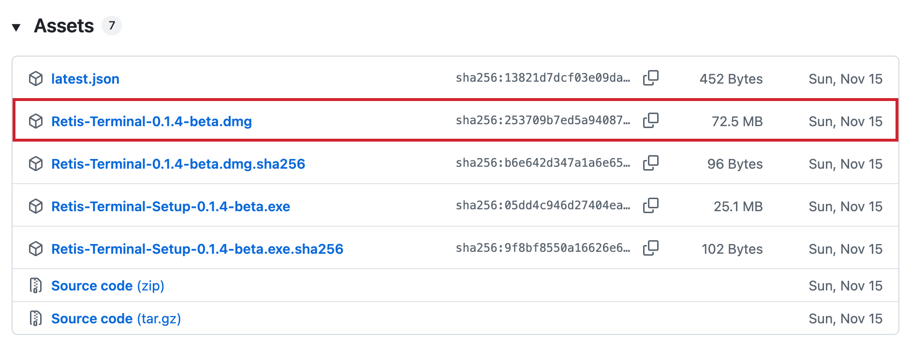
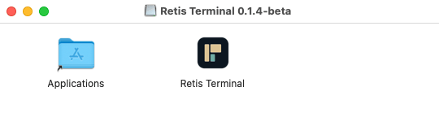
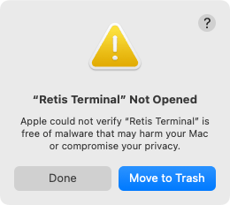
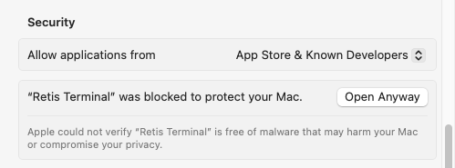

# Install Retis Terminal on Mac

About 3 minutes, no command line. Needs macOS 12 or later (Apple silicon or Intel).

1. On the [latest release](https://github.com/alvincho/retis-terminal-beta/releases/latest) page, under **Assets**, download `Retis-Terminal-<version>.dmg`.

   

2. Open it and drag **Retis Terminal** into **Applications**.

   

3. Open **Applications** and double-click **Retis Terminal**. This beta isn't signed by Apple yet, so the first time macOS says it can't verify the developer: choose **Done** (not the blue **Move to Trash**), open **System Settings → Privacy & Security**, scroll down to **Security**, choose **Open Anyway** next to "“Retis Terminal” was blocked to protect your Mac", then **Open**. Only the first time.

    

4. A Retis Terminal icon appears in the menu bar and your browser opens Retis Terminal. Click the icon to see the version, **Open** and **Quit**. Continue with [First run](first-run.md).

## Check the download (optional)

Download only from this repository's [Releases](https://github.com/alvincho/retis-terminal-beta/releases). Each installer has a `.sha256` file beside it with the installer's SHA-256 fingerprint. To check that your download is complete and unchanged, run this in Terminal:

```bash
shasum -a 256 ~/Downloads/Retis-Terminal-<version>.dmg
```

Compare the long string it prints with the one in the `.sha256` file. If they match, you're fine; if not, don't install it, and download it again.

## Good to know

- **Closing the browser tab doesn't quit Retis Terminal.** Reopen it from the menu-bar icon → **Open**; quit with **Quit**.
- **Retis MAS Manager starts at login.** Retis Terminal comes with Retis MAS Manager, which installs and runs programs on this computer, such as [Local yfinance](local-yfinance.md) and [Local OpenStreetMap](local-openstreetmap.md). It starts when you log in to your Mac and keeps running in the background, also after you **Quit** Retis Terminal. macOS may tell you that a background item was added.
- **Updates:** while it runs, Retis Terminal checks for a new version once a day. When there is one, a **New version** window appears and the menu-bar icon's menu shows **New version … → Download**. Choose **Download** and repeat steps 1–3. Your data and sign-in are kept.
- **Uninstall:** first remove Local yfinance and Local OpenStreetMap in Retis MAS Manager, then move Retis Terminal from Applications to the Trash. Your workspaces stay in `~/Library/Application Support/Retis Terminal` until you delete them. If **System Settings → General → Login Items** still lists a Retis background item, switch it off.
