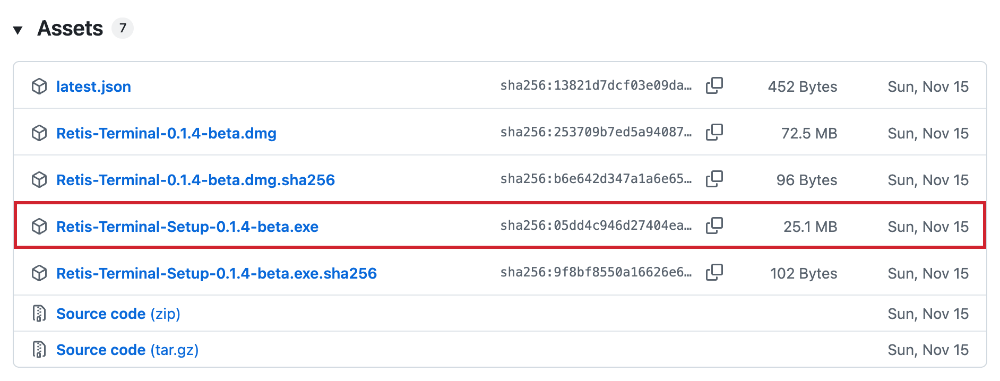
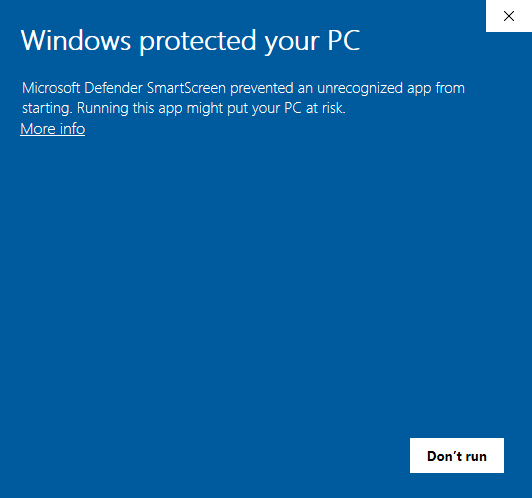
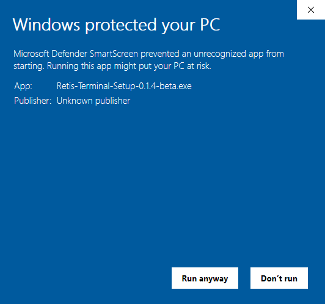
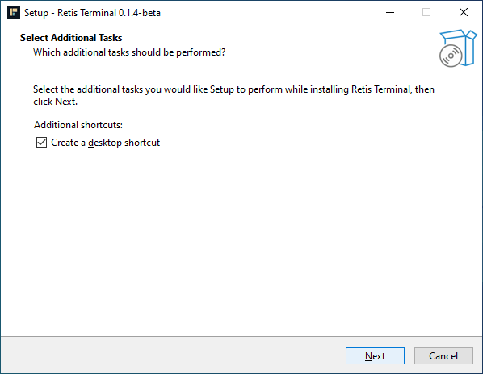
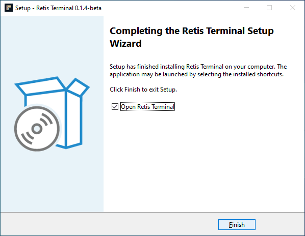
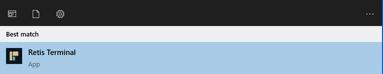

# Install Retis Terminal on Windows

About 3 minutes, no administrator rights and no command line. Windows 10 and 11 (64-bit).

1. On the [latest release](https://github.com/alvincho/retis-terminal-beta/releases/latest) page, under **Assets**, download `Retis-Terminal-Setup-<version>.exe`.

   

2. Open it. This beta isn't signed yet, so Windows may say **Windows protected your PC**: choose **More info** → **Run anyway**.

    

   Then choose **Next** to install, and **Finish** when it's done. With **Open Retis Terminal** ticked, Finish opens it.

   

   

3. To open it again later, find **Retis Terminal** in the **Start** menu, or type Retis Terminal in the search box.

   

4. A Retis Terminal icon appears in the system tray (the notification area at the bottom right; Windows may first keep it under **^**, Show hidden icons) and your browser opens Retis Terminal. Right-click the icon to see the version, **Open** and **Quit**. Continue with [First run](first-run.md).

## Check the download (optional)

Download only from this repository's [Releases](https://github.com/alvincho/retis-terminal-beta/releases). Each installer has a `.sha256` file beside it with the installer's SHA-256 fingerprint. To check that your download is complete and unchanged, run this in PowerShell:

```powershell
Get-FileHash "$env:USERPROFILE\Downloads\Retis-Terminal-Setup-<version>.exe" -Algorithm SHA256
```

Compare the long string it prints with the one in the `.sha256` file. If they match, you're fine; if not, don't install it, and download it again.

## Good to know

- **Closing the browser tab doesn't quit Retis Terminal.** Reopen it from the system tray icon → **Open**; quit with **Quit**.
- **Retis MAS Manager starts at sign-in.** Retis Terminal comes with Retis MAS Manager, which installs and runs programs on this computer, such as [Local yfinance](local-yfinance.md) and [Local OpenStreetMap](local-openstreetmap.md). It starts when you sign in to Windows and keeps running in the background, also after you **Quit** Retis Terminal. Windows adds it to your startup apps (**Settings → Apps → Startup**). When Local yfinance or Local OpenStreetMap first starts, Windows may ask about network access; see [Windows firewall](local-yfinance.md#windows-firewall).
- **Updates:** while it runs, Retis Terminal checks for a new version once a day. When there is one, a **New version** window appears and the tray icon's menu shows **New version … → Download**. Download and run the new installer. Your data and sign-in are kept.
- **Uninstall:** first remove Local yfinance and Local OpenStreetMap in Retis MAS Manager, then **Settings → Apps**, Retis Terminal, **Uninstall**. Your workspaces stay in `%LOCALAPPDATA%\Retis Terminal` until you delete them. If it's still listed under **Settings → Apps → Startup**, switch it off.
