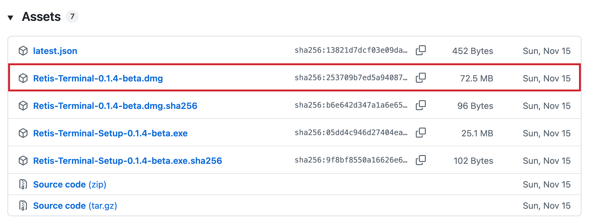
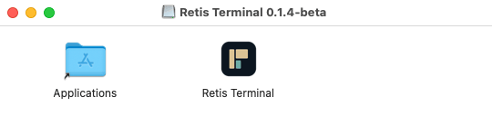
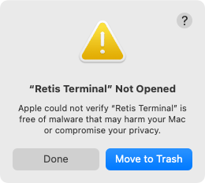
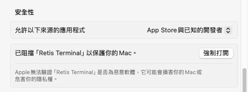
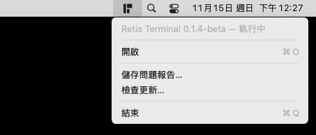

# 在 Mac 安裝 Retis Terminal

約 3 分鐘，不需要打任何指令。需要 macOS 12 以上（Apple 晶片或 Intel）。

1. 到 [最新版本](https://github.com/alvincho/retis-terminal-beta/releases/latest) 頁面，在 **Assets** 下載 `Retis-Terminal-<版本>.dmg`。

   

2. 打開下載的檔案，把 **Retis Terminal** 拖到 **應用程式（Applications）** 資料夾。

   

3. 打開 **應用程式** 資料夾，雙擊 **Retis Terminal**。測試版還沒有 Apple 簽章，第一次開啟時 macOS 會說無法驗證開發者：按 **完成**（不要按藍色的 **丟到垃圾桶**），到 **系統設定 → 隱私權與安全性**，往下捲動到「安全性」，在「已阻擋「Retis Terminal」以保護你的 Mac」旁按 **強制打開**（或 **仍要打開**），再按 **打開**。只有第一次需要。

    

   左圖是英文版 macOS 的畫面，中文版的按鈕是 **完成** 與 **丟到垃圾桶**。

4. 螢幕上方的選單列會出現 Retis Terminal 圖示，瀏覽器會自動開啟 Retis Terminal。點圖示可以看到選單。接著看 [第一次使用](first-run.md)。

   

## 確認安裝檔沒有被改過（選用）

請只從本儲存庫的 [Releases](https://github.com/alvincho/retis-terminal-beta/releases) 下載。每個安裝檔旁邊都有同名的 `.sha256` 檔，裡面是安裝檔的 SHA-256 指紋。想確認下載的檔案完整、沒有被改過，可以在「終端機」（Terminal）輸入：

```bash
shasum -a 256 ~/Downloads/Retis-Terminal-<版本>.dmg
```

把顯示的一長串字和 `.sha256` 檔裡的字比對，完全相同就沒問題；不同的話請不要安裝，重新下載一次。

## 小提醒

- **關掉瀏覽器分頁不會關閉 Retis Terminal。** 要再開啟，點選單列圖示 → **開啟**。要完全結束，點 **結束**。
- **Retis MAS 管理員會在登入時啟動。** 從 0.1.5-beta 起，Retis Terminal 附帶 Retis MAS 管理員，負責在這台電腦上安裝與執行程式，例如 [本機 yfinance](local-yfinance.md)。它會在您登入 Mac 時啟動，並在背景持續執行，按 **結束** 關閉 Retis Terminal 後也一樣。macOS 可能會通知您新增了背景項目。
- **更新：** 有新版本時，選單列圖示會顯示 **有新版本**，點 **下載** 後照第 1–3 步安裝即可，您的資料和登入都會保留。
- **移除：** 先在 Retis MAS 管理員移除本機 yfinance，再把 **應用程式** 裡的 Retis Terminal 丟到垃圾桶。您的工作區保留在 `~/Library/Application Support/Retis Terminal`，不需要時可一併刪除。如果 **系統設定 → 一般 → 登入項目** 仍列出 Retis 的背景項目，請把它關閉。
- 如果 macOS 說「無法打開，因為無法驗證開發者」，請看 [常見問題](faq.md#mac-無法打開)。
