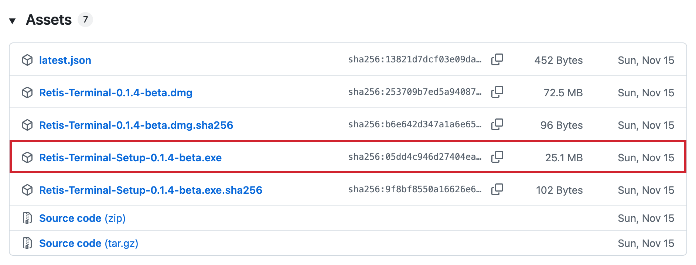
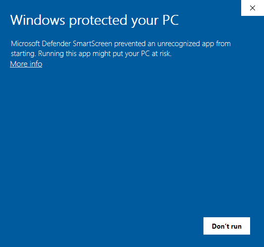
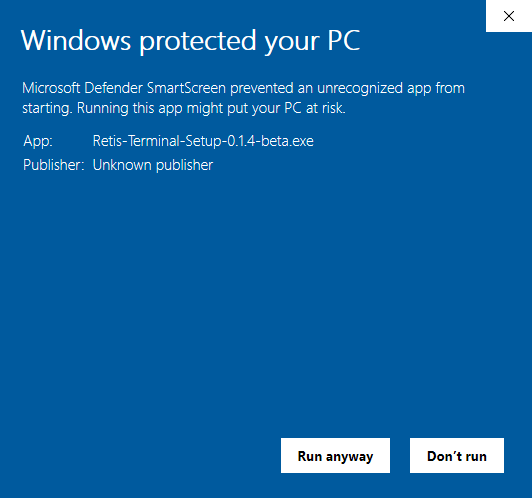
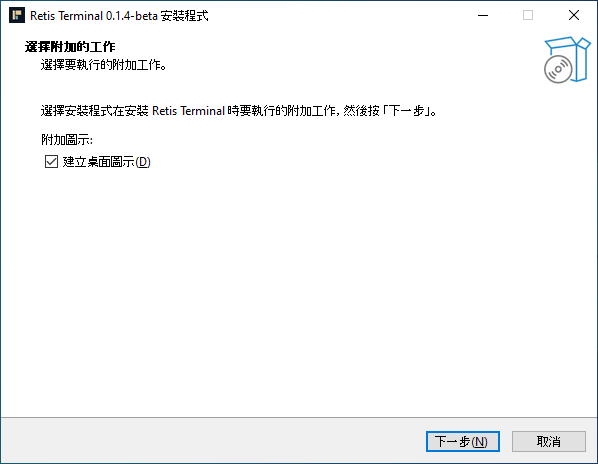
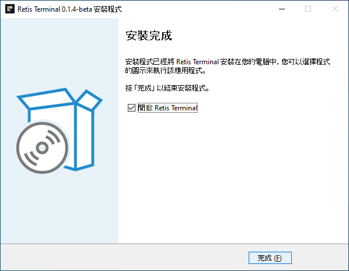
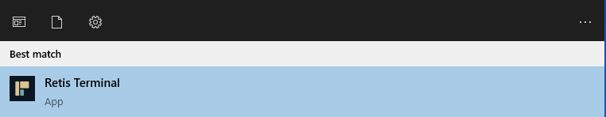

# 在 Windows 安裝 Retis Terminal

約 3 分鐘，不需要系統管理員權限，也不需要打任何指令。支援 Windows 10 與 11（64 位元）。

1. 到 [最新版本](https://github.com/alvincho/retis-terminal-beta/releases/latest) 頁面，在 **Assets** 下載 `Retis-Terminal-Setup-<版本>.exe`。

   

2. 打開下載的檔案。測試版還沒有簽章，Windows 可能會顯示「Windows 已保護您的電腦」：按 **其他資訊** → **仍要執行**。

    

   以上是英文版 Windows 的畫面，中文版的按鈕是 **其他資訊** 與 **仍要執行**。

   接著按 **下一步** 開始安裝，裝好後按 **完成**。「開啟 Retis Terminal」保持勾選，按完成就會開啟。

   

   

3. 之後要再開啟，從 **開始** 選單打開 **Retis Terminal**，或在搜尋框輸入 Retis Terminal。

   

   這是英文版 Windows 的畫面。

4. 螢幕右下角的系統匣會出現 Retis Terminal 圖示（Windows 可能先把它收在 **^**「顯示隱藏的圖示」裡），瀏覽器會自動開啟 Retis Terminal。在圖示上按右鍵可以看到 Retis Terminal 的版本，以及 **開啟** 與 **結束**。接著看 [第一次使用](first-run.md)。

## 確認安裝檔沒有被改過（選用）

請只從本儲存庫的 [Releases](https://github.com/alvincho/retis-terminal-beta/releases) 下載。每個安裝檔旁邊都有同名的 `.sha256` 檔，裡面是安裝檔的 SHA-256 指紋。想確認下載的檔案完整、沒有被改過，可以在 PowerShell 輸入：

```powershell
Get-FileHash "$env:USERPROFILE\Downloads\Retis-Terminal-Setup-<版本>.exe" -Algorithm SHA256
```

把顯示的一長串字和 `.sha256` 檔裡的字比對，完全相同就沒問題；不同的話請不要安裝，重新下載一次。

## 小提醒

- **關掉瀏覽器分頁不會關閉 Retis Terminal。** 要再開啟，點系統匣圖示 → **開啟**。要完全結束，點 **結束**。
- **Retis MAS 管理員會在登入時啟動。** Retis Terminal 附帶 Retis MAS 管理員，負責在這台電腦上安裝與執行程式，例如 [本機 yfinance](local-yfinance.md) 與 [本機 OpenStreetMap](local-openstreetmap.md)。它會在您登入 Windows 時啟動，並在背景持續執行，按 **結束** 關閉 Retis Terminal 後也一樣。Windows 會把它加入啟動應用程式（**設定 → 應用程式 → 啟動**）。本機 yfinance 或本機 OpenStreetMap 第一次啟動時，Windows 可能會詢問網路存取權限，請看 [Windows 防火牆](local-yfinance.md#windows-防火牆)。
- **更新：** Retis Terminal 開著時，每天自動檢查一次新版本。有新版本時會跳出 **有新版本** 視窗，系統匣圖示的選單也會出現 **有新版本 … → 下載**。下載後執行新的安裝檔即可，您的資料和登入都會保留。
- **移除：** 先在 Retis MAS 管理員移除本機 yfinance 與本機 OpenStreetMap，再到 **設定 → 應用程式**，找到 Retis Terminal 按 **解除安裝**。您的工作區保留在 `%LOCALAPPDATA%\Retis Terminal`，不需要時可一併刪除。如果 **設定 → 應用程式 → 啟動** 仍列出它，請把它關閉。
- 如果 Windows 顯示「Windows 已保護您的電腦」，請看 [常見問題](faq.md#windows-已保護您的電腦)。
